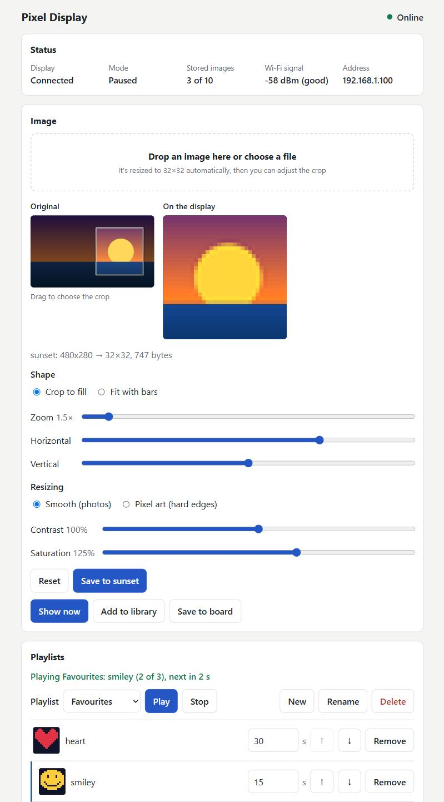

# ESP32 iDotMatrix Pixel Display

Control a 32x32 iDotMatrix pixel display over your network, using an ESP32-C3 mounted on its back and an optional web UI in Docker. The firmware keeps the display connected over BLE and offers an HTTP API on your Wi-Fi network.

```text
Web UI or HTTP client → Wi-Fi → ESP32-C3 → BLE → iDotMatrix display
```



## Features

Firmware:

- Reconnects to the display on its own after it restarts or drops the link
- HTTP stays available while the display is disconnected
- Stores up to 10 PNGs in flash, replacing the oldest first
- Clock, slideshow, brightness and screen on/off
- Rejects PNGs over 3,663 bytes, the largest size confirmed working (a 4,196 byte PNG sent as two chunks wasn't shown)
- Remembers its settings across restarts
- Firmware updates over Wi-Fi

Web UI:

- Upload any image with automatic resizing and a live preview
- Crop position and zoom, or fit with coloured bars
- Contrast, saturation and pixel-art resizing
- An image library, including adding many images at once
- Named playlists with a duration per image, previous and next buttons, and click an image to skip to it. Playlists pause while the screen is off
- Brightness, screen, clock and slideshow controls

## Hardware

- An ESP32-C3 board with USB, tested with a generic one with 4 MB of flash
- An iDotMatrix display, tested with a 32x32 panel
- A 2.4 GHz Wi-Fi network

## Setup

Copy `include/secrets.example.h` to `include/secrets.h` and fill it in. `secrets.h` is gitignored. You can find your display's Bluetooth address with any BLE scanner app.

Set `WIFI_FALLBACK_SSID` and `WIFI_FALLBACK_PASSWORD` to add a second network. The board tries each network for 20 seconds in turn until one connects, and after losing the connection it tries the same network again before moving on. `GET /status` shows which network it's on as `wifi_ssid`.

## Build

Needs Docker and nothing else. The toolchain stays in the `pio-cache` and `pio-venv` Docker volumes.

```bash
scripts/build.sh
```

Binaries end up in `dist/`.

## Flash

### First time, over USB

Run this on the Windows machine the board is plugged into. It fetches `dist/` from the build host over SSH and needs the [esptool](https://github.com/espressif/esptool/releases) executable.

```powershell
scripts\flash.ps1 -Esptool C:\path\to\esptool.exe -Port COM5 -BuildHost my-build-host -RemoteDir path/to/repo/dist
```

### Afterwards, over Wi-Fi

```bash
scripts/ota.sh pixel-display.local
```

Pass the board's IP address if `.local` names don't resolve, which is common in WSL.

## Serial output

```powershell
scripts\monitor.ps1 -Port COM5 -Seconds 30
```

Opening the port can restart the board.

## HTTP API

Replace `pixel-display.local` with the board's IP address if needed.

| Method and path | Purpose |
|---|---|
| `GET /status` | Connection state, mode, brightness, screen, image count, memory and storage |
| `POST /send-png` | Store a PNG and show it, multipart field with a `.png` filename. Doesn't change the mode, in clock mode it's only stored |
| `POST /show-png` | Show a PNG without storing it, same upload and limits. A running slideshow continues after 15 seconds, and the clock stops |
| `POST /show-gif` | Play an animated 32x32 GIF without storing it on the board, multipart field with a `.gif` filename, up to 11318 bytes. Like `/show-png` for the slideshow and clock |
| `POST /brightness` | Set brightness with `value` from 5 to 100, kept across restarts |
| `POST /screen` | Turn the screen on or off with `on` as 1 or 0, kept across restarts. While it's off the slideshow pauses and uploads are only stored, showing an image or the clock turns it back on |
| `POST /start-clock` | Show the clock, this stops the slideshow |
| `POST /slideshow/start` | Cycle through stored images every 15 seconds |
| `POST /slideshow/stop` | Stop cycling and leave the current content |
| `POST /images/clear` | Remove all stored images |
| `POST /send-raw` | Send a raw command as hex in the `plain` form field |
| `POST /update` | Upload firmware, needs the `admin` user and `OTA_PASSWORD` |

```bash
curl http://pixel-display.local/status
curl -F "file=@image.png" http://pixel-display.local/send-png
curl -X POST http://pixel-display.local/start-clock
curl -X POST http://pixel-display.local/send-raw -d "plain=0500040101"
```

Only `/update` needs a password, so keep the board off untrusted networks.

The display keeps every GIF it receives and plays its own copy when it gets the same file again, even if that copy arrived broken. If a GIF stays on its first frame, change any byte and send it again. The web UI adds a random comment to each GIF it sends for this reason.

## Web UI

A page to upload and adjust images, keep an image library and playlists, and control the display. It runs in Docker and passes requests on to the board.

Images can also come from a link: paste it in the link field or drop it on either drop zone, the server downloads it. It has to be a direct link to the image file, and links to addresses on your own network are refused, so the page can't be used to reach other machines. Library images keep their originals, so **Adjust** can change the crop or colours later. Animated GIFs stay animated with their own timing, using fewer colours and then fewer frames to fit the size limit. Turn off **Animate** to use the first frame instead, which **Save to board** needs because the board's slideshow only stores still images. Playlists have a duration per image (at least 5 seconds) and aren't limited to the board's 10 slots, because the server sends images one at a time and keeps the library in a Docker volume. They resume when the container restarts. When the server is off, the last image stays on screen until the board is told otherwise.

```bash
cp .env.example .env    # then set the board's address in .env
docker compose up -d --build
```

Open port 8032 on that machine, set `WEB_PORT` to use another one. It has no login, so only run it on a network you trust. It restarts along with Docker. `docker compose down` removes the container and keeps the library, `docker compose down -v` also deletes the library and playlists.

## Preparing images

For the command line, without the web UI. This converts any image to a PNG the display can show, using the first frame of an animation: crops to a centred square, resizes to 32x32 and reduces colors if needed to fit the size limit. It needs Docker, and the original is left alone.

```bash
scripts/prepare-image.sh photo.jpg
curl -F "file=@photo-32.png" http://pixel-display.local/send-png
```

To show an image right away without storing it, converting it only if needed:

```bash
scripts/show-image.sh photo.jpg board-address
```

The host defaults to `$PIXEL_DISPLAY_HOST`, then `pixel-display.local`.

## Based on

- https://github.com/derkalle4/python3-idotmatrix-library
- https://github.com/nj-designs/go-idot
- https://github.com/Kezii/esp32cam_rs
- https://github.com/ivesdebruycker/esp32-r2d2
